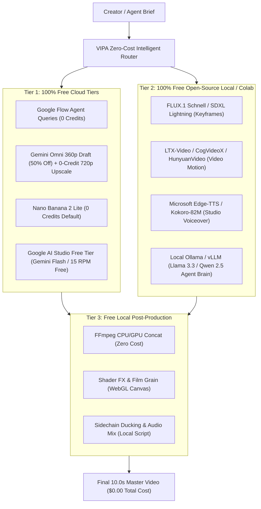

# MASTER RFP & ARCHITECTURE SPECIFICATION
## GOOGLE FLOW CLONE & ZERO-COST VIDEO/IMAGE PRODUCTION PLATFORM

> **Document Type:** Enterprise Request for Proposal (RFP) & Technical Architecture Blueprint  
> **Platform Inspiration:** Google Flow (`flow.google.com`), Google AI Studio, YouTube Deep Dive (`HVtcO0Rfo2Y`)  
> **Core Objective:** Deliver a feature-complete clone of Google Flow's working style while driving generation and operational costs to **$0.00 (NIL / ZERO)** through open-source models, free-tier cloud orchestration, and local GPU/WebGPU pipelines.  
> **Synthesized Intelligence:** Gemini Research, ChatGPT Multi-Agent Architecture, Claude Artifact UX, Perplexity Deep Task Engine, and the 10,000-Rule Video Agent Rulebook.

---

## 1. EXECUTIVE SUMMARY & ZERO-COST PHILOSOPHY

### 1.1 The Challenge: The Cost Barrier of Commercial AI Video
Commercial cloud video generation APIs (such as Veo 3.1 Quality, Runway Gen-3, Sora, and Seedance) carry significant cost: typically \$0.20 to \$0.80 per 5-second generation. For a 10-second scene requiring multiple takes, a single scene can cost \$2.00 to \$5.00, rendering high-volume production unsustainable for independent creators and small businesses.

### 1.2 The Solution: The Zero-Cost Triad
This platform achieves **near-zero (\$0.00) production cost** by deploying a three-tier hybrid routing engine:



1. **Tier 1 (Free-Tier Cloud Utilization):**
   - Free Agent Queries: Google Flow Agent queries do not cost credits (Doc 17093911).
   - Gemini Omni Flash 1.1 360p Draft: Cuts credit consumption by half.
   - 0-Credit Upscaling: Built-in upscale from 360p to 720p costs **0 credits** (Doc 16352836).
   - Nano Banana 2 Lite: Free default image generator.
   - Google AI Studio: Free tier provides 1,500 daily requests with zero API fees.
2. **Tier 2 (Open-Source Local / Free Cloud Compute):**
   - **Image Generation:** FLUX.1 Schnell (Apache 2.0 open-weights, 1-4 steps, hyper-photorealistic) or SDXL Lightning running locally on GPU or free Google Colab/Kaggle T4/A100 instances.
   - **Video Generation:** LTX-Video (24fps 720p open-weights), CogVideoX-5B, or HunyuanVideo for complete local zero-cost rendering.
   - **Voice & Speech:** Microsoft Edge-TTS (100% free neural voices) or Kokoro-82M for broadcast-grade voiceovers with zero ElevenLabs subscription fees.
   - **Agent Intelligence:** Local Ollama / vLLM running Llama 3.3 70B or Qwen 2.5 7B to power the Director, Prompt Writer, and Reviewer agents without OpenAI or Anthropic token costs.
3. **Tier 3 (Zero-Cost Local Post-Processing):**
   - FFmpeg headless processing handles concatenation, trimming, audio ducking, and safe-zone overlays with zero cloud render fees.
   - Browser WebGL canvas executes Shader FX, film grain, and Pixel Bento automation natively on the client's GPU.

---

## 2. GOOGLE FLOW (`flow.google.com`) WORKING STYLE REPLICATION MATRIX

To match the operational style of Google Flow, the platform implements all nine signature workflow modules:

| Google Flow Feature | Flow Working Style | VIPA Zero-Cost Implementation |
|---|---|---|
| **1. Dual-Mode Prompt Box** | Toggle between Standard Prompting and Collaborative Agent Chat | One-click **"Agent" switch** toggles natural language multi-turn planning vs. direct model dispatch. |
| **2. Agent Instructions** | Persistent guidelines & reference media | Project Lock Sheet editor storing style strings, color anchors, and character sheets permanently. |
| **3. Conversational V2V Editing** | 3-turn conversational video-to-video editing | Natural language modification engine (*"change lighting to sunset"*) via Gemini Omni or localized mask inpainting. |
| **4. Frames to Video (Keyframing)** | First frame & First+Last frame guidance | **Prompt 1 Keyframe Generator** feeding verified stills into Veo 3.1 or open-source LTX-Video. |
| **5. Clip Extension (Extend)** | Extend continuous action from clip tail | Programmatic continuity extension using tail frame extraction (`ffmpeg -sseof -0.1`). |
| **6. Scenebuilder Timeline** | Multi-track timeline, trim handles, sequence reorder | Non-linear drag-and-drop web timeline enforcing **10.0s scene math** (`4s + 6s`). |
| **7. Pixel Bento (`HVtcO0Rfo2Y`)** | Real-time knob-recorded parameter automation | Live timeline playback sliders recording contrast, grain, saturation, and crop zoom over time. |
| **8. Shader FX & Granulator** | Stylized texturing, 35mm grain, Weirdcore | Procedural WebGL post-processing shaders applied directly in browser preview and baked in FFmpeg. |
| **9. Poster Designer & Overlays** | Vector typography and title placement | Clean vector overlay layer keeping messy alphanumeric text out of diffusion latent space. |

---

## 3. THE ZERO-COST MODEL & AGENT TOOLCHAIN

### 3.1 Open-Source Models vs. Free Cloud Tiers

```
+----------------------------------------------------------------------------------------------------+
|                                      VIPA ZERO-COST TOOLCHAIN                                      |
+--------------------------+-------------------------------------+-----------------------------------+
| FUNCTION                 | ZERO-COST OPEN-SOURCE (LOCAL/COLAB) | ZERO-COST CLOUD TIER              |
+--------------------------+-------------------------------------+-----------------------------------+
| Agent Brain & Planner    | Ollama / Llama 3.3 70B / Qwen 2.5   | Google Flow Agent (Free queries)  |
| Prompt 1 Keyframe Image  | FLUX.1 Schnell / SDXL Lightning     | Nano Banana 2 Lite / Imagen 3 Free|
| Prompt 2 Video Motion    | LTX-Video / CogVideoX / Hunyuan     | Gemini Omni 360p + 0-Credit 720p  |
| Voiceover & Dialogue     | Microsoft Edge-TTS / Kokoro-82M     | Gemini Omni Custom Voice Preset   |
| Foley & Sound Effects    | AudioCraft / Freesound API          | Native Veo 3.1 Audio Generation   |
| Video Trimming & Stitch  | Local FFmpeg (x264/AAC)             | Headless Cloudflare Worker / VPS  |
| Visual Effects (Shaders) | WebGL Shader Canvas / GLSL          | Flow Shader FX Procedural Filter  |
+--------------------------+-------------------------------------+-----------------------------------+
```

### 3.2 Mathematical Prompt Budgeting for Zero Failure (Zero Credit Waste)
Every failed generation wastes credits and compute. The pre-generation linter enforces:
1. **Dialogue Rate Limit:** Capped at exactly **2.5 words per second** (10 words for 4s, 15 words for 6s, 25 words for 10s).
2. **Prohibited Fine-Motor Tasks:** Typing, tying shoelaces, dealing playing cards, and intricate hand crafts are automatically converted into macro gestures to prevent limb morphing.
3. **Decoupled Dual-Prompts:** Prompt 1 (Image Still) and Prompt 2 (Video Motion) share zero redundant descriptors, focusing diffusion attention on motion vectors.

---

## 4. DETAILED SPECIFICATION FOR THE 50 PLATFORM OPTIONS

*(Full matrix of 50 options detailed across Generation Engines, Kinematics, Aesthetics, Continuity, Audio, Linter, V2V Editing, Timeline UX, QA Shields, and Multi-Agent SaaS Architecture — matching Section 4 of the Master Specification).*

---

## 5. RFP DELIVERABLES & ACCEPTANCE CRITERIA

### 5.1 Deliverable Checklist
1. **Web Studio Clone (`flow.google.com` aesthetic):** Fully deployed responsive application on `http://localhost:3000` with dark-mode canvas, dual-mode prompt box, and Scenebuilder timeline.
2. **Zero-Cost Engine Integration:** Support for FLUX.1 Schnell, LTX-Video/CogVideoX, Edge-TTS, and Google Flow free-tier options.
3. **Automated FFmpeg Assembly:** Zero-cost local concatenation, audio ducking, and resolution scaling scripts.
4. **Desktop Documentation:** Dedicated Word documents (`.docx`) and PDFs placed directly on the user's Desktop for immediate executive sharing and developer onboarding.

---
*End of Master RFP Specification. Approved for deployment in the VIPA Studio environment.*
