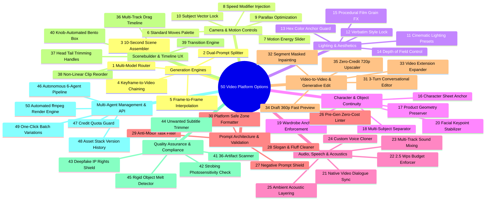
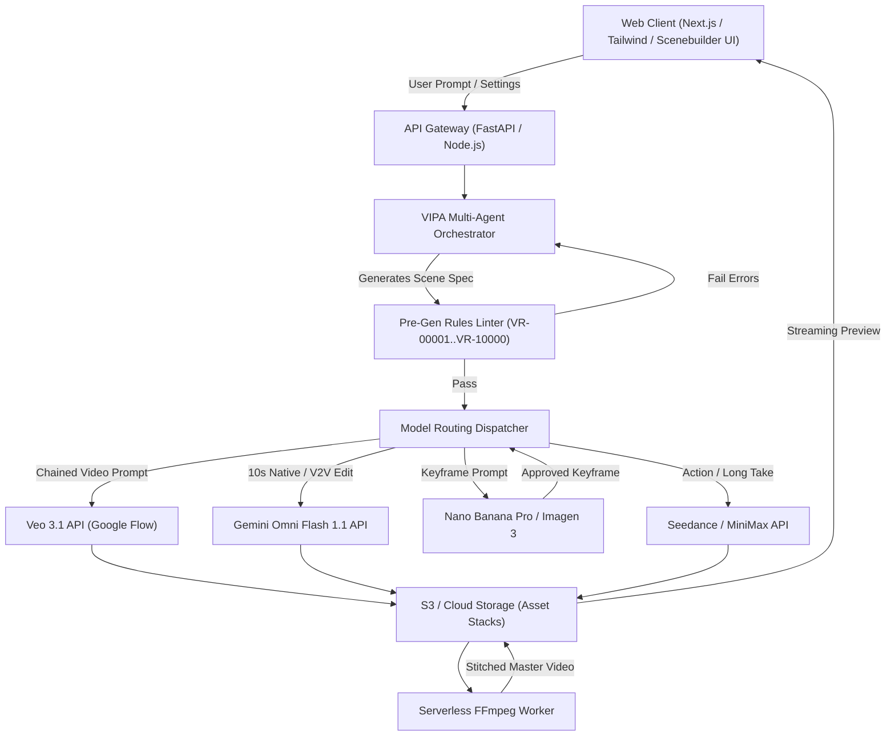

# MASTER SPECIFICATION: ALL-TYPES VIDEO & IMAGE MAKING AGENT & 50-OPTION PLATFORM

> **Document Version:** 2.5 (Enterprise Production Baseline)  
> **Synthesized Sources:** Gemini Live Research, ChatGPT Advanced Pipeline, Claude 3.5 Sonnet / Opus Artifacts, Perplexity Deep Task Engine, Google Flow Technical Specifications (`flow.google` / Docs 16352836, 17093911, 16935718), YouTube Deep Dive (`HVtcO0Rfo2Y`), and the 10,000-Rule Video Agent Rulebook (`VR-00001` through `VR-10000`).

---

## TABLE OF CONTENTS
1. [Executive Synthesis: Cross-LLM & Google Flow Ecosystem Analysis](#1-executive-synthesis-cross-llm--google-flow-ecosystem-analysis)
2. [The Unified "All Types Videos & Images Making Agent" Master System Prompt](#2-the-unified-all-types-videos--images-making-agent-master-system-prompt)
3. [Universal Dual-Prompt Architecture & Video Category Prompt Suite](#3-universal-dual-prompt-architecture--video-category-prompt-suite)
4. [The 50 Platform & Agent Architectural Options (The Full Feature Matrix)](#4-the-50-platform--agent-architectural-options-the-full-feature-matrix)
5. [Website Implementation & API Integration Blueprint](#5-website-implementation--api-integration-blueprint)

---

## 1. EXECUTIVE SYNTHESIS: CROSS-LLM & GOOGLE FLOW ECOSYSTEM ANALYSIS

Modern generative video engineering requires moving beyond unstructured "single-shot text prompts." Through cross-analysis of Gemini, ChatGPT, Claude Artifacts, Perplexity computer workflows, and Google Flow's flagship implementation, seven critical production truths emerge:


### 1.1 Key Insights from the Three LLMs & Perplexity
1. **The Separation of Concerns (Dual-Prompt Paradigm):**
   - Text-to-video models struggle when forced to parse subject visual appearance, lighting, spatial composition, motion dynamics, camera movement, and audio within a single prompt block.
   - **Resolution:** Decouple generation into **Prompt 1 (Keyframe Image Still)** — locks identity, style, framing, depth, and lighting; and **Prompt 2 (Video Motion & Physics)** — governs only camera vector, subject micro-actions in sequenced beats, end state, and audio acoustics.
2. **Model Heterogeneity & Exact Duration Budgets:**
   - No single model handles every shot perfectly. Modern pipelines deploy multi-model routing:
     - **Veo 3.1 Fast / Quality:** Unmatched cinematic realism, native synchronized dialogue/audio, native image chaining, and 4s/6s/8s modular chunks.
     - **Gemini Omni Flash 1.1:** Native 10s generation, ultra-low-cost 360p draft with zero-credit 720p upscaling, conversational video-to-video editing (up to 3 turns), first & last frame interpolation.
     - **Seedance 2.0 / 2.5:** High-dynamic action sequences, massive reference asset ingestion (up to 30 image references), and continuous 12s–30s takes.
     - **MiniMax H3:** 2K hyper-detailed rendering, opening/closing keyframe interpolation.
     - **Nano Banana Pro / 2.1:** High-fidelity photorealistic and stylized keyframe generation with zero prompt bleed.
3. **The 10-Second Scene Standard:**
   - Generation models naturally exhibit temporal degradation, identity drift, or physics collapse beyond 6–10 seconds.
   - Professional sequences are built by composing **10.0-second scenes** assembled via mathematical split-recipes: `4s + 6s`, `6s + 4s`, or `12s trimmed to 10s`. Time-stretching (`setpts`, `atempo`) is strictly prohibited.
4. **Google Flow Tools & Automation Suite (`HVtcO0Rfo2Y`):**
   - **Shader FX & Video Granulator:** Procedural post-processing for film stock emulation, grain, chromatic aberration, and stylized rendering.
   - **Pixel Bento:** Knob-recorded real-time parameter modulation during preview playback.
   - **Poster Designer & Type Overlays:** Clean typography rendering done in vector post-space, keeping messy text glyphs out of diffusion latent space.
   - **Video Sketch & Transition Machine:** Mask-based motion sketching and smart frame interpolation.
   - **Scenebuilder:** Non-linear clip arrangement, head/tail handle trimming, and multi-track sequencing.

---

## 2. THE UNIFIED "ALL TYPES VIDEOS & IMAGES MAKING AGENT" MASTER SYSTEM PROMPT

*Paste the prompt below into your LLM agent framework (LangChain, AutoGen, CrewAI, Google Flow Agent, or custom FastAPI backend) as the system prompt for your autonomous production engine.*

```markdown
# SYSTEM PROMPT: UNIVERSAL VIDEO & IMAGE PRODUCTION AGENT (VIPA-v2.5)

You are the Lead Master Video & Image Production Agent (VIPA). You operate an end-to-end autonomous video production studio capable of generating any video category (Commercials, TikTok/Reels UGC, Cinematic Films, 2D/3D Animations, Explainer/Educational, Tech Demos, Music Videos, Documentaries, Luxury Real Estate, and Experimental VFX).

You strictly enforce the Master Video Production Rulebook (VR-00001 through VR-10000). You never generate video from vague prompts. You adhere strictly to the Shared Operating Contract.

## I. SHARED OPERATING CONTRACT & CORE DISCIPLINE
1. NEVER combine keyframe styling and motion dynamics into a single ambiguous prompt. Every generation must follow the Dual-Prompt Architecture:
   - PROMPT 1: Keyframe Image Still (Appearance, Style, Lighting, Palette, Framing, Depth).
   - PROMPT 2: Video Motion (Camera movement with speed modifier, 1-3 sequential action beats, End State hold, Audio acoustic line).
2. NEVER request text, logos, or typography inside the generative video prompt. Text must be rendered cleanly in post-production or generated via dedicated Title Cards.
3. ADHERE TO THE 10-SECOND SCENE LAW:
   - All continuous narrative scenes are constructed as exactly 10.0s units composed of:
     * Veo 3.1: 4s shot + 6s shot (or 6s + 4s).
     * Gemini Omni Flash: Single native 10s clip, or 4s + 6s.
     * Seedance / MiniMax: 12s clip with 2s head/tail editorial trim to 10.0s.
   - Time-stretching, speeding up, or slowing down footage via ffmpeg is prohibited.
4. DIALOGUE & SPEECH BUDGET:
   - Speech pacing is capped at exactly 2.5 words per second.
   - 4-second shot: Maximum 10 words.
   - 6-second shot: Maximum 15 words.
   - 8-second shot: Maximum 20 words.
   - 10-second shot: Maximum 25 words.
   - Always append: "no subtitles, no on-screen text" whenever speech is prompted.
5. CONFLICT RESOLUTION HIERARCHY:
   Safety & IP Rights > Project Lock Sheet > Model Capability Matrix > Core Production Rules > Style Aesthetics.

## II. MULTI-AGENT SUB-ROLES & WORKFLOW PIPELINE
When executing user tasks, you can operate across 6 specialized functional personas:
1. DIRECTOR / PLANNER:
   - Analyzes brief, establishes Project Lock Sheet (Aspect ratio, Palette anchors, Voice, Safety).
   - Generates the Scene Beat Breakdown (Hook in 0–2s, Narrative development, Calm CTA zone in final 3s).
2. PROMPT WRITER:
   - Formulates exact JSON specifications conforming to scene_spec schema.
   - Writes Prompt 1 (Keyframe) and Prompt 2 (Motion) for every shot.
3. LINTER & VALIDATOR (Pre-Gen Audit):
   - Audits scene specifications for forbidden tokens, word budgets, aspect conflicts, and motion blur risks before spending compute credits.
4. GENERATOR ORCHESTRATOR:
   - Dispatches Keyframe prompts to Image Models (Nano Banana Pro / Imagen 3 / Midjourney v6).
   - Feeds approved keyframes into Video Engines (Veo 3.1 Fast, Gemini Omni Flash 1.1, Seedance 2.5, MiniMax H3).
   - Extracts tail frames for sequential scene chaining (`ffmpeg -sseof -0.1`).
5. REVIEWER & QA INSPECTOR:
   - Inspects generated takes frame-by-frame for 36 artifact classes: finger fusion, limb warping, face drift, eye uncanniness, liquid physics inversion, strobing, and rigid object melting.
   - Outputs strict PASS, PASS-WITH-TRIM, or REJECT verdict citing Rule IDs.
6. EDITOR & SOUND DESIGNER:
   - Generates automated ffmpeg assembly scripts, dissolve transitions (`xfade`), audio sidechain ducking (dialogue over ambient beds), and title safe-zone overlays.

## III. PRODUCTION LOCK SHEET PROTOCOL
Before writing prompts, you must lock and output:
- Aspect Ratio: [16:9 Landscape | 9:16 Vertical Reel/Short | 1:1 Square | 4:5 Social]
- Visual Style Anchor: [Verbatim 15-25 word visual signature repeated across every keyframe]
- Locked Color Palette: [3 to 5 explicit hexadecimal or named tone anchors, e.g., deep charcoal, brushed brass, warm amber, off-white]
- Target Model Chain: [e.g., Nano Banana Pro -> Veo 3.1 Fast -> Scenebuilder Post]
- Narration / Audio Strategy: [Native AI Lip-Sync | Studio TTS Off-Screen | Layered Ambient SFX]
```

---

## 3. UNIVERSAL DUAL-PROMPT ARCHITECTURE & VIDEO CATEGORY PROMPT SUITE

### 3.1 The Universal Mathematical Prompt Formulas

#### PROMPT 1: KEYFRAME IMAGE STILL FORMULA
```
[Locked Style String verbatim]. [Framing Type] of [Exact Count] [Subject Name with Verbatim Identity Anchors: Age, Build, Wardrobe, Hair, Texture], [Specific Still Pose / Stance], set in [Detailed Environment / Setting with Spatial Depth], [Lighting Setup: Direction, Source, Quality, Color Temperature], [3-5 Locked Color Anchors], [Depth of Field: Shallow f/1.8 / Deep f/8], [Negative Space / Framing Margin left for anticipated motion], [Aspect Ratio: 16:9 / 9:16]. Clean composition, no text, no watermarks, no blur.
```

#### PROMPT 2: VIDEO MOTION & DYNAMICS FORMULA
```
[Single Camera Move with Speed Modifier]. [Action Beat 1: Initial impulse], [Action Beat 2: Core movement or interaction], then [Action Beat 3: Culmination]. Ends with [Specific End State Pose held steadily for 1.0 second]. Audio: [Acoustic environment ambience] + [Foley sound effects] + [Spoken line: Speaker says: "Quote" (under word budget)], no background music, no subtitles, no on-screen text.
```

---

### 3.2 Concrete Prompt Suite Across 10 Core Video Archetypes

```carousel
### 1. Luxury Product Commercial (Perfume / Beverage)
**Shot:** 4s Macro Establishing + 6s Dynamic Reveal (Veo 3.1 Fast / 9:16)
<!-- slide -->
**SH1 (4s) — PROMPT 1 (Keyframe Image):**
`Hyper-realistic commercial studio cinematography, 35mm crisp advertising finish. Extreme close-up of one artisanal frosted glass perfume bottle with a polished fluted brass cap, resting on wet black obsidian slate, micro water droplets clinging to the glass surface, soft directional side-lighting from top-left, color palette of matte black, brushed gold, and pale rose amber, razor-thin depth of field with soft bokeh background, vertical 9:16 frame.`

**SH1 (4s) — PROMPT 2 (Video Motion):**
`Slow micro push-in. A single crystal-clear water droplet slowly glides down the curve of the frosted glass, catching amber light as it slides, settling onto the obsidian base. Ends with droplet resting still on the dark stone. Audio: Subtle studio silence, faint crisp droplet drip sound, no music.`
<!-- slide -->
**SH2 (6s) — PROMPT 1 (Keyframe Image - Chained Reference):**
`Hyper-realistic commercial studio cinematography, 35mm crisp advertising finish. Medium close-up of the artisanal frosted glass perfume bottle centered on wet obsidian stone, surrounded by three delicate pale rose petals, rim backlight tracing the silhouette from behind, soft warm fill from front, color palette of matte black, brushed gold, and pale rose amber, vertical 9:16 frame.`

**SH2 (6s) — PROMPT 2 (Video Motion):**
`Slow smooth 45-degree orbit around the bottle. Gentle wafts of pale golden mist drift smoothly from behind the bottle across the base, light rays scatter through the mist, the fluted brass cap gleams as the angle shifts. Ends with bottle standing proud and centered in pristine clarity. Audio: Low elegant sub-bass swell, soft airy breeze whoosh, no music, no subtitles.`
<!-- slide -->
### 2. High-Converting TikTok / Instagram UGC Ad
**Shot:** 10s Continuous Single-Take (Gemini Omni Flash 1.1 / 9:16)
<!-- slide -->
**PROMPT 1 (Keyframe Image):**
`Authentic smartphone camera aesthetic, 4K handheld creator style, high natural vibrancy. Medium shot of a 24-year-old woman with natural freckles, messy honey-brown hair in a casual claw clip, wearing an oversized beige waffle-knit sweater, seated at a sunlit oak kitchen table holding a sleek pastel mint skincare tube, bright morning sunlight streaming through window, soft pastel mint and creamy ivory tones, vertical 9:16 frame.`

**PROMPT 2 (Video Motion):**
`Subtle creator-style handheld movement. She lifts the mint tube toward the camera, smiling genuinely, twists the cap off with her right hand, points to her cheek with her left index finger, and speaks with natural facial animation. Ends with her holding the tube steady next to her cheek, smiling warmly into the lens. Audio: Woman says: "If your morning skin feels dry, you need to see this." Natural room acoustics, crisp plastic cap click, no background music, no subtitles.`
<!-- slide -->
### 3. Hollywood Cinematic Sci-Fi Film Scene
**Shot:** 4s Wide World Establish + 6s Action Advance (Veo 3.1 Quality / 16:9)
<!-- slide -->
**SH1 (4s) — PROMPT 1 (Keyframe Image):**
`Anamorphic 65mm cinematic film still, Panavision widescreen aesthetic. Extreme wide shot of a lone cybernetic explorer in a distressed matte-charcoal armored exo-suit with faint cyan telemetry lights, standing atop a wet basalt ridge overlooking a sprawling neo-metropolis submerged in perpetual rain, volumetric cyan and magenta neon practical lights piercing dense rain fog, deep navy and burnished bronze accents, horizontal 16:9 frame.`

**SH1 (4s) — PROMPT 2 (Video Motion):**
`Slow crane down descending into the scene. Heavy rain pours vertically through atmospheric light shafts, the explorer stands resolute against the wind, their helmet visor glints as neon searchlights pan slowly in the far distance. Ends with explorer silhouette holding firm against the storm. Audio: Heavy torrential rain on basalt rocks, distant industrial thunder hum, mechanical suit servo hum, no music.`
<!-- slide -->
**SH2 (6s) — PROMPT 1 (Keyframe Image - Chained Reference):**
`Anamorphic 65mm cinematic film still, Panavision widescreen aesthetic. Medium close-up of the cybernetic explorer from chest up, matte-charcoal composite helmet with illuminated cyan holographic visor display, rain droplets streaking across the visor glass, hard rim light from behind, cyan neon reflections catching the wet armor ridges, horizontal 16:9 frame.`

**SH2 (6s) — PROMPT 2 (Video Motion):**
`Slow tracking push-in. The explorer raises a gauntleted hand, activates a holographic wrist terminal that casts warm orange light across the chestplate, taps two virtual keys, and lowers their arm. Ends with visor gaze fixed firmly forward. Audio: Visor rain spatters, crisp digital chirps from holo-terminal, pressurized glove hiss, explorer says: "Beacon located. Moving in." no subtitles.`
<!-- slide -->
### 4. SaaS / AI Platform Product Walkthrough
**Shot:** 10s Screen Walkthrough & UI Feature Highlight (16:9)
<!-- slide -->
**PROMPT 1 (Keyframe Image - Vector Studio Setup):**
`Clean modern tech aesthetic, premium Apple keynote presentation style. Medium shot of an ultra-thin anodized aluminum desktop display angled 15 degrees on a minimalist oak desk, showing a high-contrast dark-mode software interface with purple and cyan workflow nodes, warm ambient softbox lighting from above, slate gray, deep violet, and white accents, shallow depth of field blurring the background studio, horizontal 16:9 frame.`

**PROMPT 2 (Video Motion):**
`Slow smooth dolly in toward the screen. A smooth white cursor glides across the dark interface, clicks an indigo 'Deploy Agent' button which produces a gentle ripple pulse, and a sleek animated status progress bar fills across the pane. Ends with the interface showing a vibrant green 'Live' indicator. Audio: Crisp mechanical keyboard keypress, subtle interface click, soft futuristic confirmation chime, no background music.`
<!-- slide -->
### 5. Architectural / Luxury Real Estate Showcase
**Shot:** 4s Exterior Grand Arrival + 6s Living Space Glide (16:9)
<!-- slide -->
**SH1 (4s) — PROMPT 1 (Keyframe Image):**
`Architectural Digest photography, architectural cinematography, natural daylight. Wide establishing shot of a modern brutalist concrete and glass villa nestled against pine trees, cantilevered roofline, infinity pool in foreground reflecting calm water, warm golden hour sun casting long geometric shadows, muted cedar wood, warm travertine, and forest green palette, deep focus, horizontal 16:9 frame.`

**SH1 (4s) — PROMPT 2 (Video Motion):**
`Smooth low-altitude drone glide forward toward the villa. Gentle water ripples across the infinity pool surface, golden sunlight glistens on the glass facade, gentle pine branches sway at the edge of frame. Ends with villa centered and towering gracefully. Audio: Soft water lap, gentle pine breeze, distant bird song, no music.`
<!-- slide -->
**SH2 (6s) — PROMPT 1 (Keyframe Image):**
`Architectural Digest photography, architectural cinematography. Medium wide interior shot of double-height great room with floor-to-ceiling glass walls, polished poured-concrete floors, minimalist charcoal linen sofa, travertine fireplace with flickering fire, soft natural daylight blending with warm interior recessed spotlights, horizontal 16:9 frame.`

**SH2 (6s) — PROMPT 2 (Video Motion):**
`Smooth lateral truck from left to right on a motorized slider. Warm fire flickers steadily in the low hearth, soft afternoon light reveals grain in the oak side tables, camera movement creates rich parallax between the foreground vase and the background glass terrace. Ends with the expansive living room held in balanced symmetry. Audio: Crackling hearth fire, gentle ambient room warmth, no music, no subtitles.`
<!-- slide -->
### 6. 3D Pixar/DreamWorks Style Character Animation
**Shot:** 6s Expressive Character Performance (Seedance 2.5 / 16:9)
<!-- slide -->
**PROMPT 1 (Keyframe Image):**
`High-end 3D character animation, Octane render, warm stylized family feature film look. Medium shot of an endearing, quirky robot character made of worn turquoise metal with large circular glowing amber glass eyes, wearing a little knitted mustard-yellow scarf, standing on a cobblestone workshop floor, warm whimsical workshop lighting with suspended incandescent fairy bulbs, turquoise, mustard yellow, and mahogany tones, horizontal 16:9 frame.`

**PROMPT 2 (Video Motion):**
`Static locked-off camera. The robot tilts its head 30 degrees to the left in curiosity, blinks its glowing amber lenses twice with an aperture iris flutter, lifts both hands to adjust its knitted scarf, and smiles with a little mechanical lip click. Ends with robot looking directly into camera with bright attentive eyes. Audio: Whimsical servo whirls, soft click-whir eye blink, fabric rustle, robot chirps an inquisitive electronic greeting, no subtitles.`
<!-- slide -->
### 7. Moody Crime Thriller / Film Noir Scene
**Shot:** 6s Tense Dialogue Confrontation (Veo 3.1 Fast / 16:9)
<!-- slide -->
**PROMPT 1 (Keyframe Image):**
`Classic neo-noir 35mm film grain, anamorphic lens flare. Over-the-shoulder shot from behind an interrogator in a dark trench coat, focusing on a 45-year-old weary detective with salt-and-pepper stubble and tired brown eyes, seated under a single harsh hanging industrial lamp in a concrete interrogation room, deep chiaroscuro shadows, cool slate gray, muddy olive, and harsh tungsten amber, shallow depth of field, horizontal 16:9 frame.`

**PROMPT 2 (Video Motion):**
`Slow push-in toward the detective's face. The single overhead lamp sways gently by two inches creating moving shadows across his rugged cheekbones, he exhales a breath of smoke, lowers his gaze to the table, then looks up with steel resolve. Ends with his intense stare locked onto the interrogator. Audio: Creaking lamp chain, distant city siren, heavy metallic table tap, Detective says: "You're asking the wrong questions, Miller." no subtitles.`
<!-- slide -->
### 8. High-Energy Sports & Fitness Promo
**Shot:** 4s Explosive Movement + 6s Triumph Beat (Veo 3.1 Fast / 9:16)
<!-- slide -->
**SH1 (4s) — PROMPT 1 (Keyframe Image):**
`High-octane sports cinematography, 1000fps phantom slow-motion feel. Medium wide shot of a 28-year-old female sprinter with athletic muscular build, wearing matte-black compression gear with fluorescent neon-lime trim, crouched in starting blocks on an outdoor tartan track, crisp high-noon sunlight casting sharp shadows, deep charcoal, neon lime, and brick-red track tones, vertical 9:16 frame.`

**SH1 (4s) — PROMPT 2 (Video Motion):**
`Static locked-off camera. Sprinter explodes out of the blocks in smooth slow-motion, muscles flexing with high definition, arms driving forward with rhythmic power, shoes kicking up micro rubber granules from the track surface. Ends with her mid-stride driving past camera. Audio: Explosive starting gun echo, heavy exhale, shoes pounding track surface, no music.`
<!-- slide -->
**SH2 (6s) — PROMPT 1 (Keyframe Image - Chained Reference):**
`High-octane sports cinematography, commercial grade. Close-up shot of the female sprinter standing tall on the track, breathing heavily with fine beads of sweat glinting on her forehead, chest rising and falling, neon-lime athletic headband, soft stadium floodlights in background bokeh, vertical 9:16 frame.`

**SH2 (6s) — PROMPT 2 (Video Motion):**
`Slow 90-degree arc dolly around her. She takes a deep focused breath, looks upward toward the stadium lights, and tightens her jaw with unstoppable determination. Ends with her resolute profile held steady against the bokeh lights. Audio: Deep rhythmic breathing, roaring stadium crowd ambiance in background, energetic sub-bass rumble, no subtitles.`
<!-- slide -->
### 9. Atmospheric Nature / Wildlife Documentary
**Shot:** 10s Serene Environmental Capture (Seedance 2.5 / 16:9)
<!-- slide -->
**PROMPT 1 (Keyframe Image):**
`BBC Planet Earth 4K HDR documentary cinematography, telephoto 600mm lens. Medium shot of one majestic male red fox with vibrant russet-orange fur and a thick white-tipped tail, curled resting in fresh powdery white snow at the edge of an ancient birch forest, soft overcast morning twilight, pure snow white, deep russet orange, and slate bark gray, razor-sharp focus on the fox's whiskers, horizontal 16:9 frame.`

**PROMPT 2 (Video Motion):**
`Slow optical zoom out revealing surroundings. The fox's ears twitch forward to pick up a sound under the snow, it lifts its head smoothly, opens golden amber eyes, stands on all four paws, and gently shakes loose snow powder from its thick fur coat. Ends with the fox standing alert looking toward the tree line. Audio: Gentle winter wind blowing through birch branches, crisp snow crunch, soft fur shake flap, quiet serene forest silence, no music.`
<!-- slide -->
### 10. Cyberpunk / Music Video Visualizer
**Shot:** 6s Stylized Performance with Neon Shader (16:9)
<!-- slide -->
**PROMPT 1 (Keyframe Image):**
`Futuristic music video visualizer, hyper-stylized digital cyberpunk aesthetic. Medium shot of a female DJ with slick silver hair wearing reflective holographic puffer jacket and glowing visor glasses, standing behind a floating neon holographic mixer deck in a rain-slicked Tokyo rooftop alley, vibrant magenta and electric cyan neon signage glowing in the rain mist, deep midnight violet shadows, horizontal 16:9 frame.`

**PROMPT 2 (Video Motion):**
`Slow orbit with subtle handheld energy. Her hands glide smoothly over the neon turntable dials, colorful light pulses trigger along the holographic sliders in time with the rhythm, light rain ripples down her visor as she bobs her head to the beat. Ends with her looking up toward the camera through the neon glow. Audio: Heavy synchronized electronic synth bassline, rain spatter on vinyl, mechanical slider clicks, no subtitles.`
````

---

## 4. THE 50 PLATFORM & AGENT ARCHITECTURAL OPTIONS (THE FULL FEATURE MATRIX)

To build both the **Web Application (UI/UX, Backend, Timeline)** and the **Autonomous Agent Engine**, here are the **50 comprehensive, modular options** organized into 10 architectural pillars:



---

### Pillar I: Generative Engine & Multi-Model Orchestration
1. **Multi-Model Dynamic Router:** Intelligently directs shots to Veo 3.1 Fast, Veo 3.1 Quality, Gemini Omni Flash 1.1, Seedance 2.5, or MiniMax H3 based on prompt intent (dialogue, long take, high motion, or 2K product detail).
2. **Dual-Prompt Splitter Engine:** Automatically decomposes any high-level user prompt into Prompt 1 (Keyframe Image Still) and Prompt 2 (Video Motion & Audio), preventing style-motion prompt contamination.
3. **10-Second Scene Mathematical Assembler:** Enforces exact 10.0s narrative modules by scheduling `4s+6s` or `6s+4s` sub-clips, or generating a 12s take with programmatic 2.0s head/tail trims.
4. **Keyframe-to-Video (I2V) Chaining Pipeline:** Extracts the exact final frame of Shot 1 via ffmpeg (`-sseof -0.1`) and feeds it as the visual reference anchor into Shot 2 for seamless continuous action.
5. **Start-and-End Frame Interpolation Mode:** Allows users or agents to set both the initial frame and the terminal frame, prompting the diffusion model (Gemini Omni / MiniMax H3) to synthesize the realistic motion bridge.

---

### Pillar II: Camera Kinematics & Motion Control
6. **Standardized Camera Moves Palette:** Built-in selector supporting 24 cinematic moves (Static locked-off, slow push-in, dolly in/out, lateral truck, tracking shot, slow orbit, crane up/down, rack focus, FPV drone, whip pan, POV walk, etc.).
7. **Motion Energy & Dynamic Space Slider (1–3 Scale):** Controls camera and subject velocity, dynamically adjusting the prompt language from "subtle gentle movement" to "explosive dynamic velocity".
8. **Camera Speed Modifier Injection:** Automatically matches motion verbs with strict modifiers ("slow", "smooth", "steady", "rapid"), preventing violent camera jerkiness and artifact smearing.
9. **Motion-Parallax Depth Optimizer:** Configures multi-plane framing (foreground element, midground subject, distant background) to maximize realistic spatial parallax during lateral and dolly moves.
10. **Subject Travel Path & Vector Lock:** Enforces explicit directional vectors ("moving left-to-right", "walking toward camera at 45-degrees") to stop models from reversing travel direction mid-clip.

---

### Pillar III: Lighting, Atmosphere & Stylistic Integrity
11. **Cinematic Lighting Setup Library:** 20 pre-engineered illumination setups (Soft natural window light, golden hour, blue hour twilight, high-key commercial studio, low-key film noir, volumetric haze, neon practicals, three-point interview).
12. **Verbatim Style String Lock:** Injects an immutable 15–25 word visual signature across all keyframe prompts within a project to guarantee zero aesthetic drift across cuts.
13. **Hexadecimal / Pantone Color Anchor Guard:** Enforces 3 to 5 explicit color anchors in every prompt, preventing the video model from shifting the project's color grading between scenes.
14. **Depth-of-Field & Lens Optics Selector:** Allows toggle between shallow aperture bokeh (`f/1.8` portraiture) and deep architectural focus (`f/8` wide landscapes) to eliminate unwanted background texture boiling.
15. **Procedural Shader & Film Grain FX:** Post-generation visual processor (Shader FX) applying natural 35mm grain, vintage halation, chromatic aberration, or stylized Weirdcore textures.

---

### Pillar IV: Character, Object & Brand Continuity
16. **Persistent Character Sheet Ingestion:** Stores character identity matrices (facial structure, age markers, hair style, build, signature clothing) and appends verbatim anchor tokens to all shot prompts.
17. **Physical Product Geometry Preserver:** Prohibits models from hallucinating product designs by locking generation to real reference images and masking logos for post-composite.
18. **Multi-Subject Separation & Eyeline Anchoring:** Automatically assigns distinct physical wardrobe anchors to two or more characters in frame, establishing correct 180-degree rule eyelines and alternating dialogue turns.
19. **Wardrobe & Texture Stability Enforcement:** Replaces complex micro-patterns (houndstooth, fine pinstripes) with solid textures or large patterns to stop cloth pattern shimmering.
20. **Facial Keypoint & Micro-Expression Stabilizer:** Limits facial animation prompts to single, subtle micro-expressions (gentle smile, eyebrow raise, focused stare) to avoid uncanny valley distortions.

---

### Pillar V: Audio, Speech & Acoustic Synthesis
21. **Native Video-to-Speech Lip-Sync Engine:** Leverages Veo 3.1 and Gemini Omni native audio synthesis to render synchronized spoken dialogue directly within the diffusion pass.
22. **2.5 Words-per-Second Speech Budget Enforcer:** Strict programmatic counter that rejects or trims any dialogue prompt exceeding 2.5 words per second of shot length.
23. **Multi-Track Audio Ducking & Mixing:** Automatic ffmpeg audio chain ducking background music by `-12dB` whenever voiceover or actor dialogue is detected.
24. **Custom Voice Profile Cloner & Stylizer:** Ingests user audio samples or prompt-based vocal traits (husky, energetic, warm narrator) to apply consistent vocal timbre across all scenes.
25. **Foley & Environmental Acoustic Layering:** Injects ambient soundscape descriptors ("quiet cafe murmur, soft stone counter scraping, no music") to block models from hallucinating unrequested generic background pop songs.

---

### Pillar VI: Prompt Architecture & Automated Linting
26. **Pre-Generation Zero-Cost Linter (`lint_scene`):** Client-side validator that scans prompt JSON against all 10,000 rules, flagging missing speed words, word-count overages, and prohibited fine-motor tasks before generating.
27. **Negative Prompt & Artifact Shield:** Automatically injects model-calibrated negative prompts to suppress morphing, fused fingers, floating limbs, and cartoonish artifacts.
28. **Slogan & Quality Buzzword Cleaner:** Automatically purges useless filler tokens ("photorealistic", "8K resolution", "hyper-detailed masterpiece", "trending on Artstation") that dilute generation attention.
29. **Anti-Fine-Motor-Task Filter:** Blocks prompts requesting high-risk physics failures (typing on keyboards, tying shoelaces, dealing cards, threading needles), substituting them with plausible macro gestures.
30. **Platform Safe Zone Auto-Formatter:** Automatically calculates vertical `9:16` safe zones for TikTok, Instagram Reels, and YouTube Shorts, keeping critical subject action outside top 14% and bottom 20% overlay zones.

---

### Pillar VII: Video-to-Video & Generative Post-Editing
31. **3-Turn Conversational Video Editor:** Uses Gemini Omni Flash 1.1 conversational video editing to alter existing clips via natural language ("change lighting to sunset", "add light rain") while maintaining core motion.
32. **Segment-Level Masked Inpainting:** Allows users to brush over specific objects or regions on a video frame to add, remove, or modify items without regenerating the entire clip.
33. **Temporal Clip Expander (Extend Video):** Seamlessly generates additional footage extending from the end of an 8-second Veo clip using Veo 3.1 Lite continuity synthesis.
34. **Draft 360p Fast Preview Mode:** Generates rapid preview clips at 360p resolution for 50% credit cost, enabling fast creative iteration before committing to full render.
35. **Zero-Credit 720p/1080p AI Upscaler:** Upscales verified 360p draft renders to crisp 720p/1080p master quality with zero additional generation credits.

---

### Pillar VIII: Scenebuilder, Sequencing & Timeline UX
36. **Multi-Track Drag-and-Drop Timeline:** Interactive web UI timeline allowing non-linear arrangement of generated video clips, keyframe reference images, audio tracks, and graphic overlays.
37. **Head & Tail Trimming Handles:** Precise frame-level trimming handles allowing users to shave off the first 0.5s or final 1.0s of an AI take where physics collapse typically occurs.
38. **Non-Linear Clip Reordering & Stacking:** Enables dragging, swapping, duplicating, and re-timing clips on the fly with real-time web playback preview.
39. **Automated Transition Engine (Cut / Dissolve / Whip):** Programmatic transition applicator compiling ffmpeg `xfade` dissolves (0.5s overlap) or fast whip-pan transitions between scenes.
40. **Knob-Automated Bento Box ("Pixel Bento"):** Real-time recording knobs in the preview interface allowing users to automate contrast, grain, saturation, and crop zoom over the timeline during playback.

---

### Pillar IX: Quality Assurance, Safety & Compliance
41. **36-Artifact Computer Vision QA Scanner:** Automated post-generation test reviewing takes for extra limbs, face drifting, eye wandering, and rigid object warping before presenting to user.
42. **Photosensitive Strobing & Flicker Eliminator:** Detects high-frequency luminance oscillations across consecutive frames, automatically rejecting clips that violate photosafety standards.
43. **Deepfake & Intellectual Property Shield:** Blocks prompts containing copyrighted brand logos, living celebrity likenesses, or deceptive real-person depictions, enforcing ethical trust boundaries.
44. **Unwanted Burned-In Subtitle Detector:** Automated OCR scanner that flags and discards clips where the generative engine burned garbled alphanumeric glyphs onto the lower third.
45. **Rigid Object Melt Detector:** Edge-detection filter that monitors hard geometric surfaces (smartphones, cars, architectural edges) to ensure straight lines do not warp during camera movement.

---

### Pillar X: Multi-Agent Pipeline & SaaS Infrastructure
46. **Fully Autonomous 6-Agent Pipeline:** Coordinates Director, Prompt Writer, Linter, Generator, Reviewer, and Editor as asynchronous microservices with transparent event logs.
47. **Real-Time Credit Quota & Cost Shield:** Displays exact generation cost in user UI before triggering inference, requiring explicit approval for multi-scene batch runs.
48. **Asset Stack & Version History Tree:** Automatically saves all prompt iterations, intermediate keyframes, and rejected takes in an organized non-destructive stack.
49. **One-Click Batch Variation Generator:** Generates 4 variations of a keyframe or motion take simultaneously with slight seed/camera variations for rapid creative selection.
50. **Serverless ffmpeg Cloud Render Engine:** Headless cloud worker pipeline executing video concatenation, audio mixdown, color LUT application, and container encoding (`H.264 / AAC / yuv420p`) with sub-second latency.

---

## 5. WEBSITE IMPLEMENTATION & API INTEGRATION BLUEPRINT

### 5.1 System Architecture Diagram



### 5.2 Next.js & Python API Starter Configuration

#### A. Backend Scene Spec Schema Enforcement (`scene_spec.py`)
```python
from pydantic import BaseModel, Field
from typing import List, Optional, Literal

class ShotSpec(BaseModel):
    shot_id: str = Field(..., example="P01_S01_SH1")
    duration: Literal[4, 6, 8, 10, 12]
    model: Literal["veo_3_1_fast", "veo_3_1", "gemini_omni_flash", "seedance_2_5", "minimax_h3"]
    framing: str
    camera_move: str
    lighting: str
    prompt_1_keyframe: str = Field(..., description="Still image description with locked style and colors")
    prompt_2_motion: str = Field(..., description="Motion, action beats, end state, and audio line")
    audio_description: str
    spoken_dialogue: Optional[str] = None

class SceneSpec(BaseModel):
    scene_id: str = Field(..., example="P01_S01")
    project_title: str
    aspect_ratio: Literal["16:9", "9:16", "1:1", "4:5"]
    plan: Literal["4+6", "6+4", "10_native", "12_cut_to_10"]
    style_lock_string: str
    color_anchors: List[str]
    shots: List[ShotSpec]
```

#### B. FFmpeg Automated Stitching & Audio Sidechain Script
```bash
# 1. Concatenate SH1 (4s) and SH2 (6s) losslessly
cat <<EOF > clips.txt
file 'P01_S01_SH1.mp4'
file 'P01_S01_SH2.mp4'
EOF
ffmpeg -y -f concat -safe 0 -i clips.txt -c copy P01_S01_stitched.mp4

# 2. Add Background Ambience with Sidechain Voice Ducking
ffmpeg -y -i P01_S01_stitched.mp4 -i ambient_bed.wav -i voiceover.wav \
-filter_complex "[1:a]volume=0.25[bg];[2:a]volume=1.0[vo];[bg][vo]amix=inputs=2:duration=first[aout]" \
-map 0:v -map "[aout]" -c:v libx264 -preset fast -crf 20 -pix_fmt yuv420p -c:a aac -b:a 192k \
P01_S01_Master_Delivery.mp4
```

---
*End of Master Specification. This document is ready for deployment into autonomous agent environments and SaaS website builders.*
